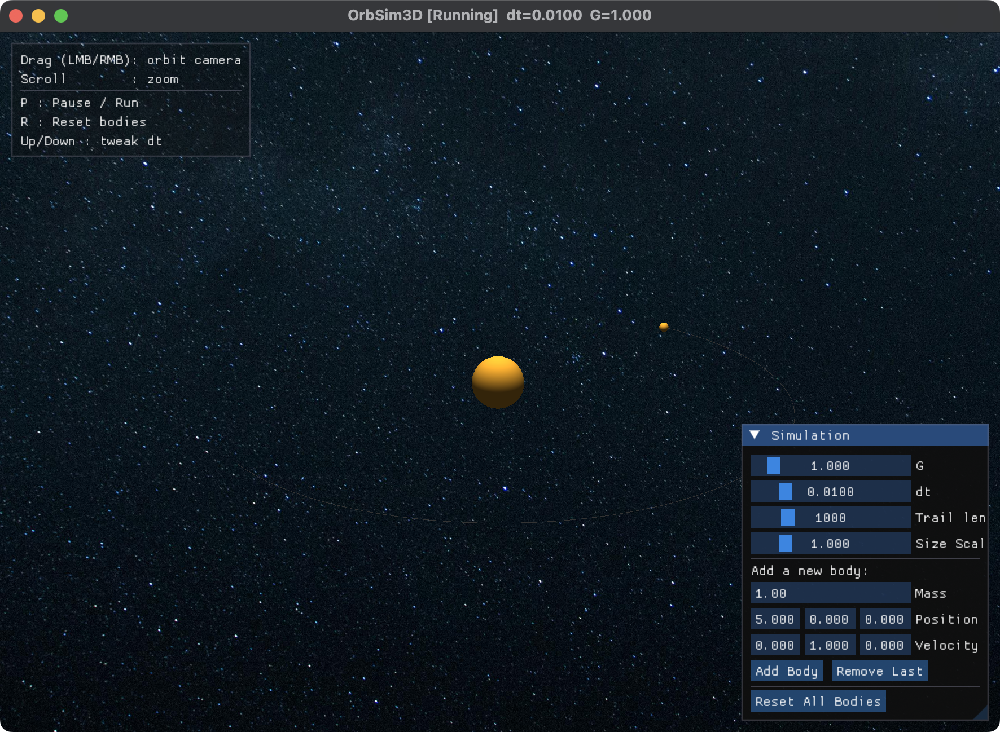
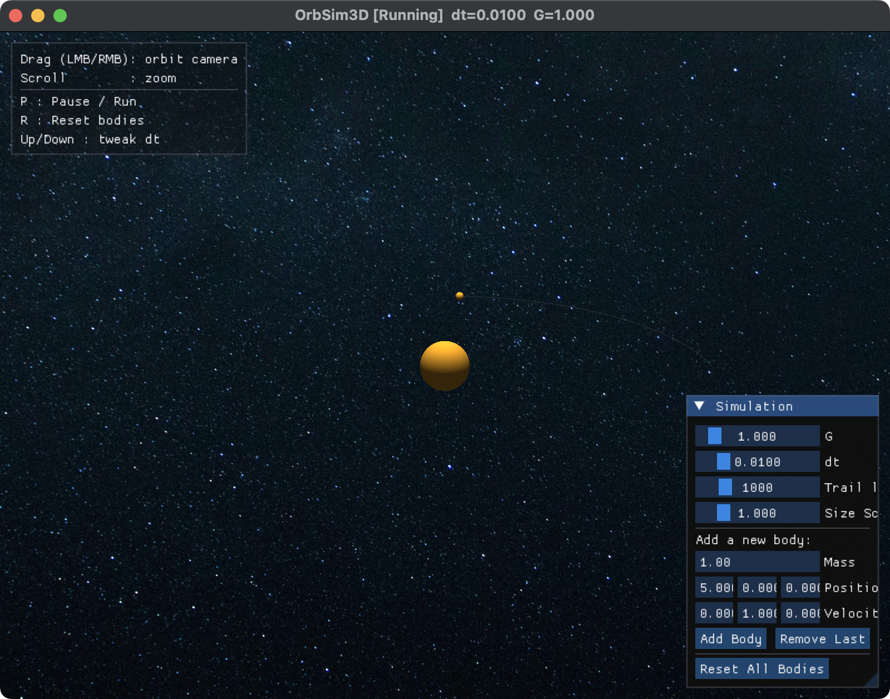

# OrbSim3D

A real-time 3D gravity simulator written in C++ and OpenGL. Bodies attract each
other under Newtonian gravity, and you can watch the orbits form, pause the
simulation, change the physics parameters, and drop in new bodies while it runs.



## What it does

The simulation integrates an N-body gravitational system in real time and draws
it with a simple lit sphere for each body and a line trail showing where each
body has been. A cubemap starfield sits behind the scene, and an orbit camera
follows the center of mass so the system stays framed as it moves.

Everything is adjustable from the control panel while the simulation is running:
the gravitational constant, the time step, how long the trails are, the size of
the rendered bodies, and the list of bodies itself.

## Features

- N-body gravity solved with a fourth-order Runge-Kutta integrator, with a
  forward-Euler fallback for trivial cases
- Softened force law so close encounters stay stable
- Orbit camera you can rotate and zoom with the mouse
- Live controls (Dear ImGui): tune G and dt, change trail length and body
  scale, add or remove bodies, reset the scene
- Per-body orbit trails
- Cubemap skybox for the background
- Pause, reset, and time-step hotkeys

## Controls

| Input              | Action                          |
| ------------------ | ------------------------------- |
| Drag (left/right)  | Orbit the camera                |
| Scroll             | Zoom in and out                 |
| P                  | Pause or resume                 |
| R                  | Reset the bodies                |
| Up / Down arrows   | Nudge the time step up or down  |

The panel in the bottom-right adds bodies (set a mass, position, and velocity),
removes the last one, and resets the whole system.



## Building

Tested on macOS with Apple Silicon and system OpenGL.

### Requirements

- CMake 3.18 or newer
- A C++20 compiler
- [Eigen](https://eigen.tuxfamily.org), [GLM](https://github.com/g-truc/glm),
  and [GLFW](https://www.glfw.org)

On macOS with Homebrew:

```bash
brew install cmake eigen glm glfw
```

Dear ImGui and stb are pulled in as git submodules, and GLAD is vendored in
`third_party/glad`.

### Build and run

```bash
git clone <your-repo-url> OrbSim3D
cd OrbSim3D
git submodule update --init --recursive

cmake -S . -B build
cmake --build build
```

The build copies the `shaders` and `assets` folders next to the executable, so
run it from the build directory:

```bash
cd build
./OrbSim3D
```

## How it works

**Physics.** `PhysicsEngine` holds the list of bodies and steps them forward in
time. Forces are the sum of pairwise Newtonian attractions with a softening term
that keeps the acceleration finite when two bodies get very close. Each step
uses classic RK4, which stays far more stable than plain Euler at the time steps
used here. Vector math is handled by Eigen.

**Rendering.** `Renderer` sets up an OpenGL 3.3 core context through GLFW and
GLAD. Each body is drawn as a UV sphere lit by a single point light, sized by the
cube root of its mass so the drawn volume tracks the real mass. Trails are
streamed into a vertex buffer each frame and drawn as line strips. The background
is a cubemap rendered with its own shader.

**Camera.** `Camera` is a spherical orbit camera stored as yaw, pitch, and
distance around a target point. Each frame the target is set to the current
center of mass, so the camera keeps the system centered as it drifts.

## Project layout

```
include/        Public headers (Body, PhysicsEngine, Renderer, Camera)
src/            Implementation and the main loop
shaders/        GLSL for the spheres and the skybox
assets/skybox/  Cubemap face textures
third_party/    GLAD (vendored), Dear ImGui and stb (submodules)
```

## Third-party libraries

[GLFW](https://www.glfw.org), [GLAD](https://glad.dav1d.de),
[GLM](https://github.com/g-truc/glm), [Eigen](https://eigen.tuxfamily.org),
[Dear ImGui](https://github.com/ocornut/imgui), and
[stb_image](https://github.com/nothings/stb).
